# Versions

Each design version has a git tag and a screenshot folder. See the
[CHANGELOG](../CHANGELOG.md) for details.

| Version | Tag | Look | Screenshots |
| --- | --- | --- | --- |
| v3.1 | `v3.1` | Bigger brain, closed-loop task + "Be the decoder" game, live zoom activity | [v3.1](versions/v3.1) |
| v3 watercolor | `v3-watercolor` | Same site as a pigment-on-paper theme (`?theme=watercolor`) | [v3](versions/v3) |
| v2.2 | `v2.2` | + Spike Sorter game | [v2.2](versions/v2.2) |
| v2.1 | `v2.1` | Space Grotesk, resolution zoom, consistent logos | [v2.1](versions/v2.1) |
| v2 editorial | `v2-editorial` | Warm ink, Instrument Serif + Inter, one orange accent | [v2](versions/v2) |
| v1 neon | — (screenshots only) | Neon cyan/magenta, Space Grotesk, glass + bloom | [v1](versions/v1) |
| v0 legacy | in `legacy/` | Jon Barron academic template | — |

## v3.1

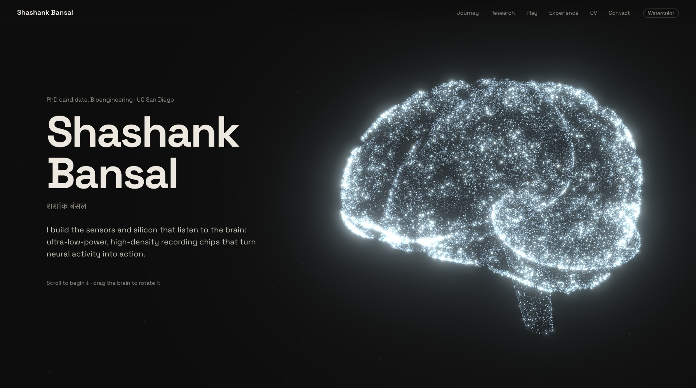
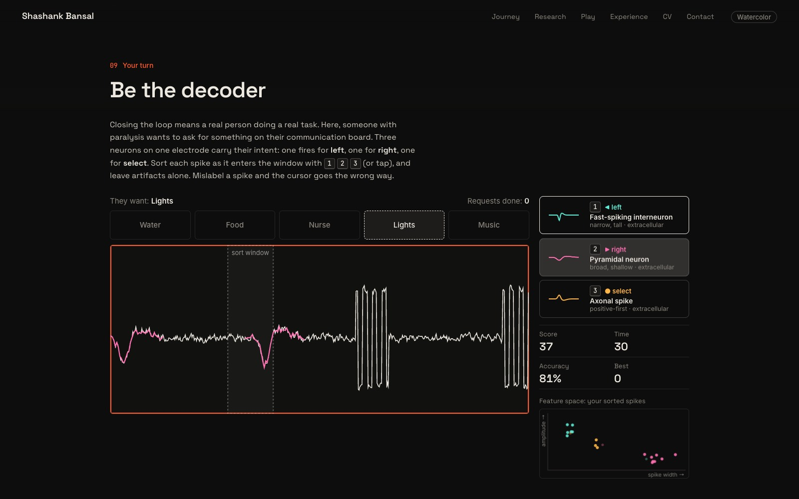
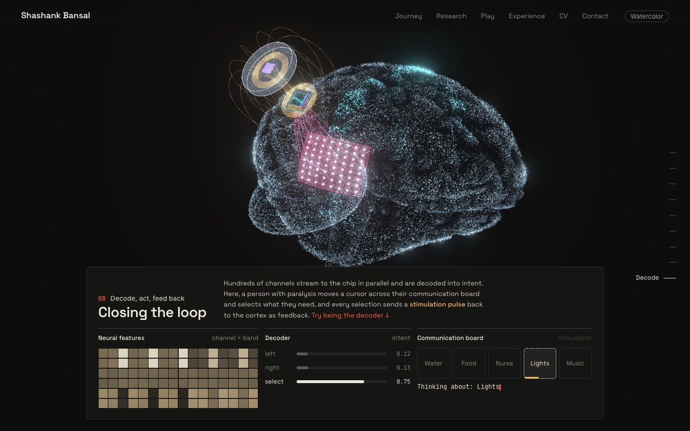

## v3 watercolor

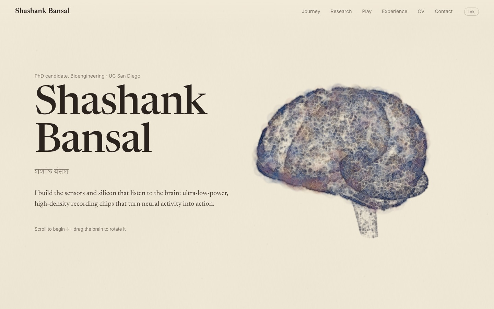
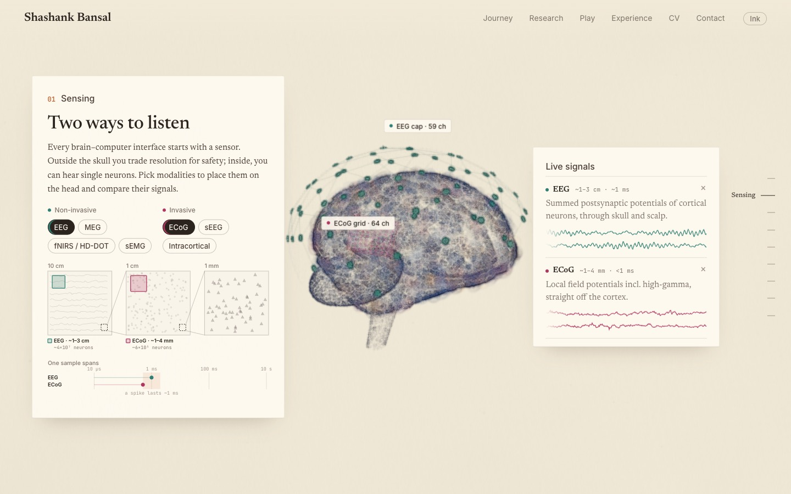
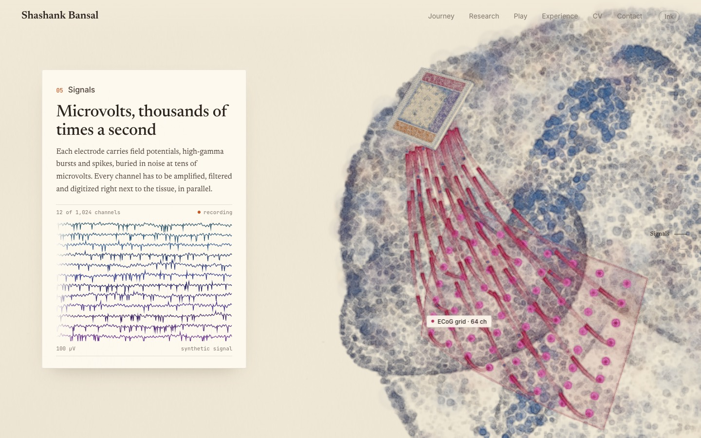
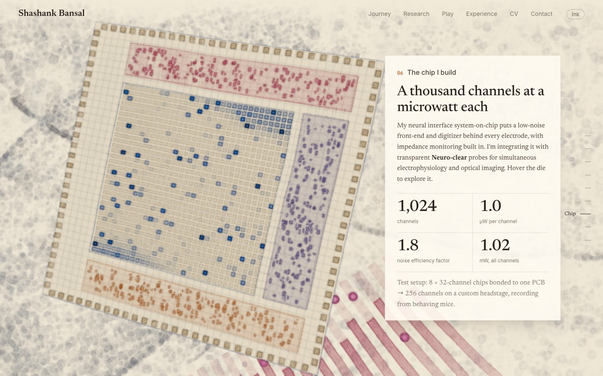

## v2.2

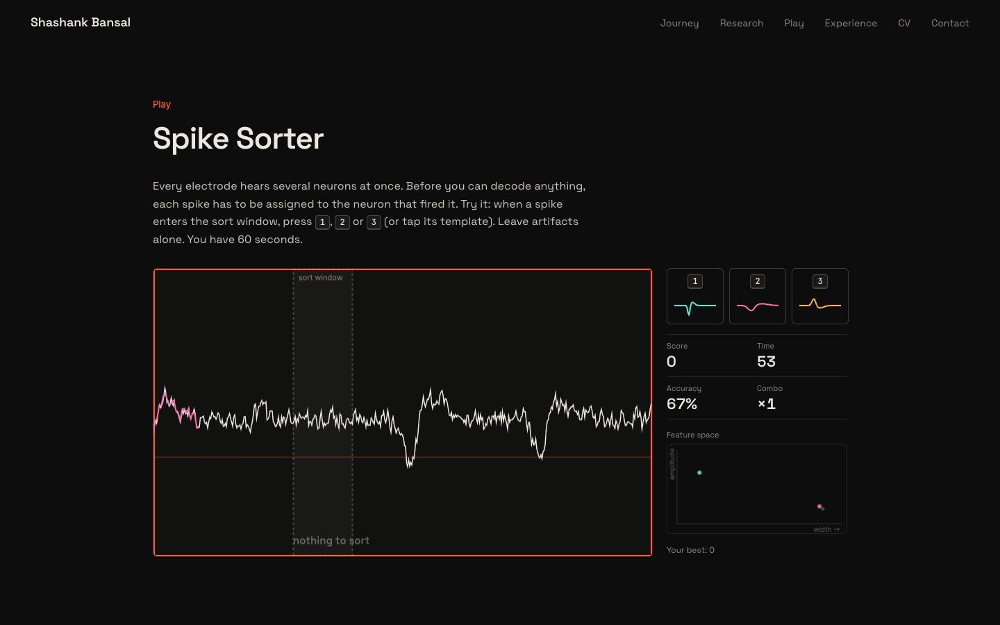

## v2.1

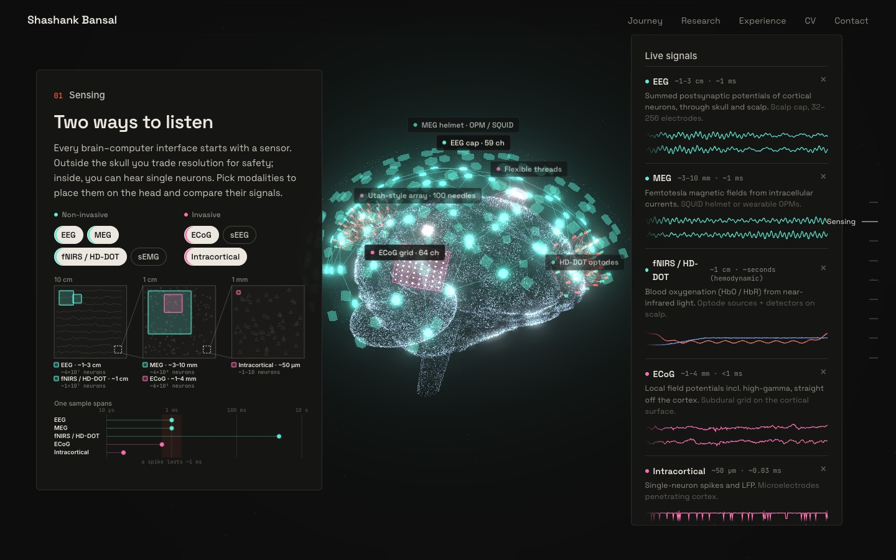

## v2 editorial

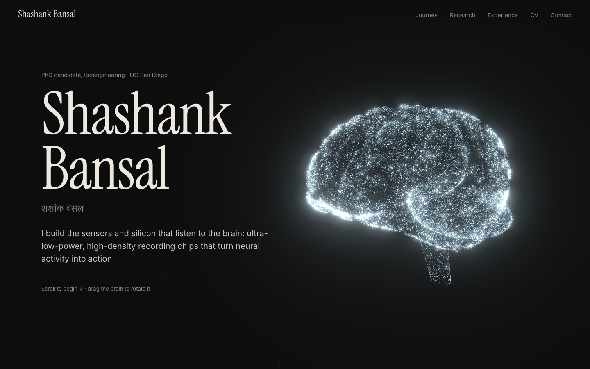
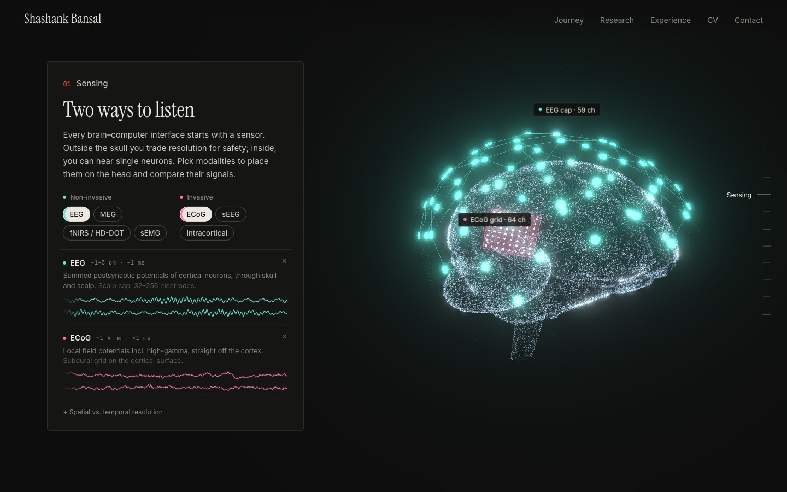
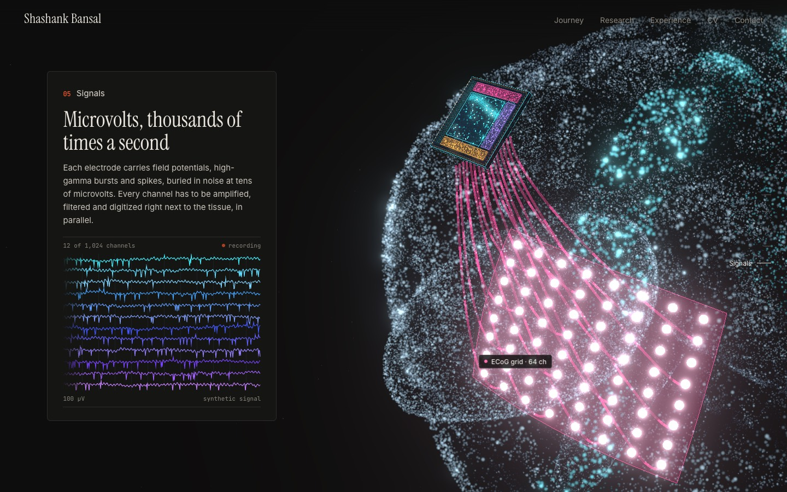
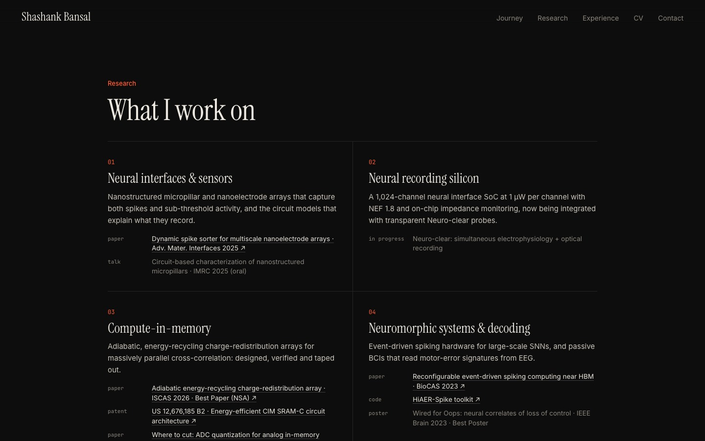

## v1 neon

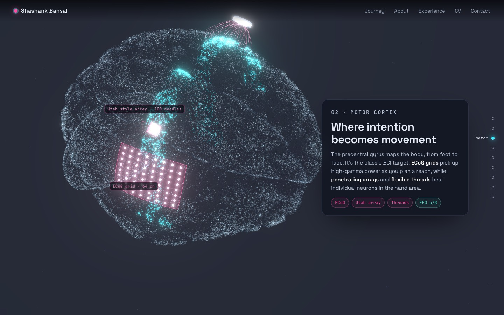
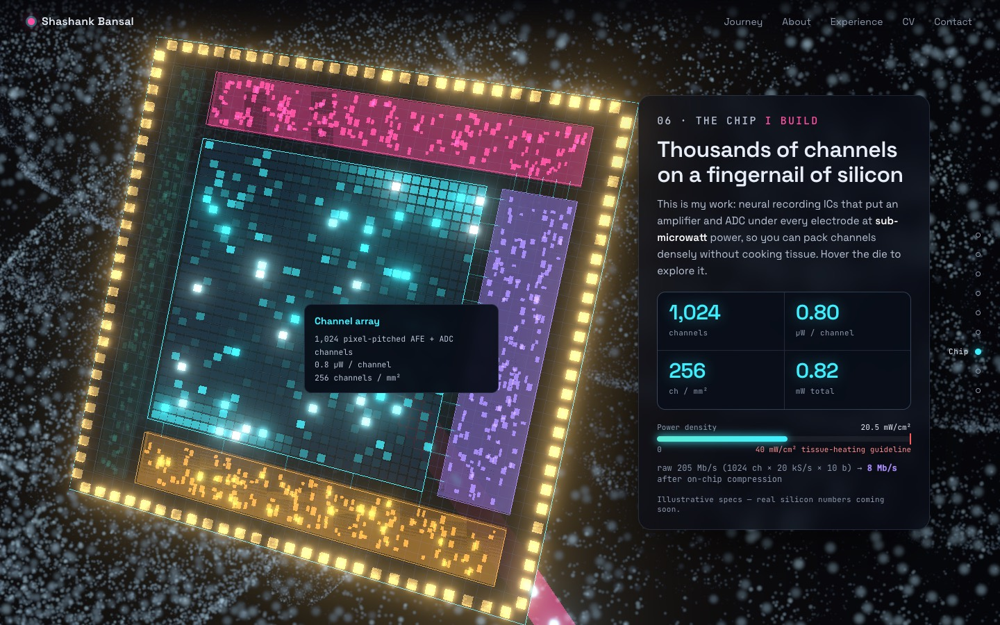
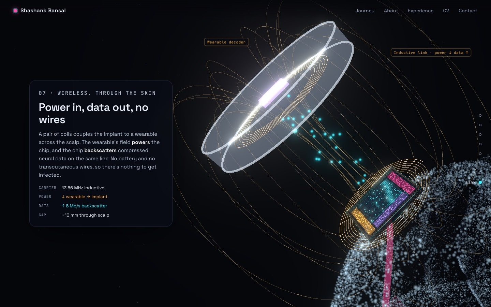
